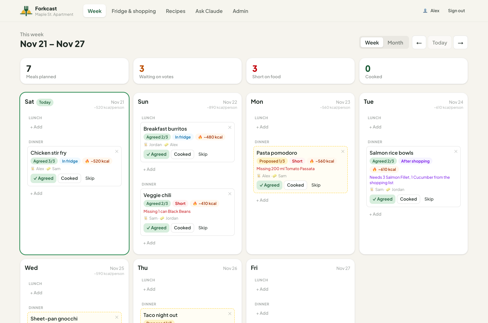
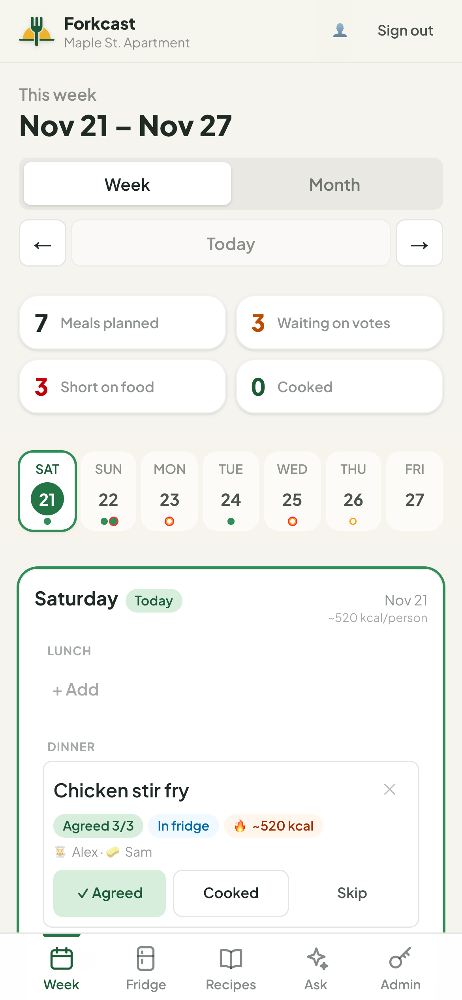
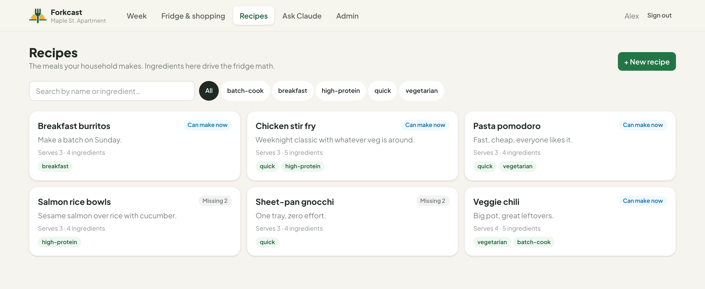

<div align="center">


# Forkcast

**The meal planner for people who share a fridge.**

Vote on the week's meals together, see which days you'll be short on food *before* you get there, and let the fridge keep track of itself.

[Features](#features) · [Screenshots](#screenshots) · [Deploy your own](#deploy-your-own-free) · [Privacy](#your-data-stays-yours) · [Reminders](#reminders-email-and-discord) · [Security](#lock-down-your-vercel-account) · [Run locally](#run-it-locally)

</div>



---

## Why Forkcast?

Living with roommates usually means a group chat full of *"what are we eating?"*, three bags of rice nobody remembers buying, and finding out at 7 pm that someone used the last of the chicken.

Forkcast makes your household's food one shared plan:

- **Decide together.** Anyone can propose a meal, and everyone else votes. You choose whether one vote, a majority, or the whole household is needed.
- **Know before you're short.** Forkcast walks through the week day by day, pulling ingredients from the fridge, and tells you exactly which meal comes up short and what's missing.
- **The fridge updates itself.** Hit **Cooked** and the ingredients come out of the fridge, scaled to how many people you cooked for. Made a mistake? **Undo** puts them back.
- **Scan your receipt.** Snap the receipt after a grocery run and Forkcast suggests exactly what to add to the fridge, ticking items off the shopping list.
- **Nobody forgets.** An evening email or Discord message nudges whoever hasn't voted, warns when tomorrow has nothing agreed, and reminds everyone if planning day slipped by.
- **Shop at the right time.** Give a grocery run a day, and Forkcast counts it from that day onward. If you shop on Tuesday, Monday's dinner still shows as short.

## Features

| | |
|---|---|
| 📅 **Flexible week planner** | Lunch, dinner, or any slots you like. Drag meals between days, skip or remove them. Liked last week? **Repeat last week** fills just the empty slots. |
| 🧽 **Who cooks, who cleans** | Every meal can have a cook and a dishwasher. Pick them yourselves, or let Forkcast rotate them fairly (dishes can be "never the cook"). A weekly tally keeps it honest, and the evening reminder says who's on duty tomorrow. |
| 🗳️ **Planning day** | Pick a day (Friday by default) and everyone gets a reminder to plan the week ahead. |
| 🧊 **Live fridge** | Quantities with real units: 500 g covers "0.4 kg", and 1 l covers "2 cups". |
| 🛒 **Smart shopping list** | One click turns everything you're missing into a dated shopping list. **Bought** moves it into the fridge. |
| 📖 **Recipe box** | Your household's recipes, with a "Can make now" badge based on what's in the fridge. |
| 🥗 **Built-in recipe library** | 30 easy, healthy lunches and dinners (15–40 min), sorted by what you can make right now. One click copies a recipe into your recipe box, sized for your household. |
| 🧾 **Receipt scanning** | **Quick scan** reads the receipt on your phone for free. **Claude scan** decodes abbreviations, works out amounts and skips non-food. Both match items to your shopping list and the names you already use, and you review everything before it's added. |
| 📬 **Evening reminders** | By email, Discord, or both, only when needed: meals waiting on your vote, nothing agreed for tomorrow, or next week still unplanned after planning day. Discord gets one message for the household and @mentions whoever's behind. |
| ✨ **Ask Claude** | *"Something cozy with the leftover chicken"* gets you recipe ideas built around your fridge. Save any idea with one click. |
| 👤 **Your own profile** | Everyone can change their own display name, turn off their reminder emails, and add a Discord ID for @mentions. Nobody can change anyone else's. |
| 🔐 **Private by design** | Email and password accounts. New members wait for an admin to approve them, and nothing is visible without a login. |
| 📱 **Works on your phone** | A proper mobile layout with bottom navigation, made for checking the fridge at the store. |

## Screenshots

<table>
<tr>
<td width="68%"></td>
<td width="32%"></td>
</tr>
<tr>
<td colspan="2"></td>
</tr>
</table>

<sub>Screenshots use a made-up demo household.</sub>

## How it works

```
 Propose meal ──► Roommates vote ──► Forecast checks the fridge, day by day
                                            │
                       ┌────────────────────┼─────────────────────┐
                    In fridge         After shopping            Short
                                     (covered by a dated     (shows exactly
                                      shopping-list item)     what's missing)
                                            │
                 Cook it ──► ingredients leave the fridge ──► forecast updates
```

## Deploy your own (free)

Forkcast is a single Next.js app that runs on Vercel's free tier. No database to set up: your household's data is a handful of JSON files in a private Vercel Blob store.

1. **Fork this repo**, then import your fork at [vercel.com/new](https://vercel.com/new).
2. In your Vercel project, open **Storage → Create → Blob**, choose **Private** access, and connect the store to the project. This sets `BLOB_READ_WRITE_TOKEN` or `BLOB_STORE_ID` automatically (either works).
3. In **Settings → Environment Variables**, add these for **Production and Preview**:

   | Variable | Required | What it's for |
   |---|---|---|
   | `AUTH_SECRET` | ✅ | Signs login sessions. Use a long random string, e.g. the output of `openssl rand -base64 32`. |
   | `ANTHROPIC_API_KEY` | | Turns on *Ask Claude*. You can also paste the key in **Admin → Settings** instead. |
   | `ADMIN_EMAILS` | | Comma-separated emails that become admins automatically when they sign up. |
   | `ALLOW_SIGNUPS` | | Set to `false` once everyone has joined, to stop new sign-up requests. |
   | `IDEAS_DAILY_LIMIT` | | Claude requests (ideas + receipt scans) per person per day (default 20). |
   | `CRON_SECRET` | for reminders | A long random string. Vercel sends it to the daily reminder job so nobody else can trigger it. |
   | `SMTP_HOST`, `SMTP_PORT`, `SMTP_USER`, `SMTP_PASS` | for reminders | Where reminder emails are sent from. See [Reminders](#reminders-email-and-discord). |
   | `DISCORD_WEBHOOK_URL` | | Posts reminders to a Discord channel. You can also paste it in **Admin → Settings** instead. |
   | `EMAIL_FROM` | | Sender, e.g. `Forkcast <you@gmail.com>`. Required if `SMTP_USER` isn't an email address. |
   | `APP_URL` | | Link used in emails. Defaults to your Vercel production URL. |

4. **Redeploy** (environment changes only apply to new deployments), open your site, and **create your account first**. The first account becomes the admin.
5. Share the link with your roommates and approve them under **Admin**.

> **Seeing "Setup needed: …" when you sign up?** The message names the missing setting. Fix it in Vercel, then redeploy.

> **Tip:** leave Vercel's **Git Fork Protection** on (it's on by default). Pull requests from other people's forks then can't run with your environment variables until you approve them.

## Reminders (email and Discord)

Every evening (around 8–9 pm US Eastern; change the time in `vercel.json`, which uses UTC), Forkcast checks the plan and speaks up only if there's something to say:

- 🗳️ **Meals waiting on your vote:** upcoming meals (next 14 days) you haven't agreed to yet.
- 🍽️ **Nothing agreed for tomorrow:** with the empty slots or the meals still waiting on votes.
- 📅 **Planning day was missed:** from planning day until the week starts, if next week still has empty days.

Admins choose the channels under **Admin → Settings → Evening reminders**: 📧 email, 💬 Discord, or both. They share the same daily job (`CRON_SECRET` is required either way) and the household time zone.

### Email setup

Each roommate gets **at most one** email per evening. Vote reminders go just to you; the rest go to everyone. Don't want them? Click your name in the header and turn off reminder emails under **Your profile**.

**Setup with a Gmail account (free, no domain needed):**

1. Turn on [2-Step Verification](https://myaccount.google.com/security) for the Gmail account that will send the emails.
2. Create an [app password](https://myaccount.google.com/apppasswords) named "Forkcast".
3. In Vercel, set `SMTP_HOST=smtp.gmail.com`, `SMTP_PORT=465`, `SMTP_USER=` that Gmail address, `SMTP_PASS=` the app password, and a random `CRON_SECRET`. Then redeploy.
4. In **Admin → Settings**, pick your time zone and click **Send test email to me**, then **Send reminders now**.

Any SMTP provider works (Resend, Postmark, SendGrid, Fastmail…). If its login isn't an email address, also set `EMAIL_FROM`. Admins can turn the emails off in Settings.

### Discord setup

Discord gets **one** combined message per evening in the channel you pick, with a **Waiting on votes** list.

1. In Discord, open **Server Settings → Integrations → Webhooks → New Webhook**, choose the channel, and click **Copy Webhook URL**.
2. Paste it in **Admin → Settings → Evening reminders**, or set `DISCORD_WEBHOOK_URL` in Vercel and redeploy (the environment variable wins). The URL stays on the server and never reaches the browser. Only real `https://discord.com/api/webhooks/…` URLs are accepted.
3. Turn on Discord and click **Send test to Discord**.

**Want an @mention?** In Discord, open **User Settings → Advanced**, turn on **Developer Mode**, then right-click your name and **Copy User ID**. Paste it under **Your profile**. People without an ID are listed by name. Forkcast only pings those user IDs, never `@everyone`.

## Your data stays yours

This repository holds **code only**, so it's safe to keep public:

- **No household data in git.** Meals, recipes, fridge contents, shopping lists and accounts live in *your* private Blob store (or a git-ignored `./.data/` folder when running locally). Planning and cooking never create a commit.
- **No secrets in git.** All keys live in environment variables. `.env*` files are ignored.
- **Nothing visible without an approved account.** Every API route checks for one. Pending sign-ups only see their own status. Password hashes and API keys never reach the browser.
- **Hidden from search engines.** The app sends `noindex` headers and a `robots.txt` that blocks all crawlers.
- **Protected against password guessing.** After eight wrong passwords in a row, an account locks for 15 minutes.
- **Abuse limits built in.** Sign-in and sign-up are rate-limited per IP, at most 10 sign-ups can wait for approval at once, request bodies are capped at 64 KB, and API changes are only accepted from your own site (CSRF protection).
- **Capped AI spend.** Each person gets 20 Claude requests (ideas and receipt scans) per day (change it with `IDEAS_DAILY_LIMIT`), so a leaked password can't run up your API bill.
- **Safe concurrent edits.** Saves are conditional on the file's version, so two roommates saving at the same moment can't overwrite each other.

*Ask Claude* and *Claude scan* are the only features that send household data to a third party: your request, fridge list or receipt photo goes to the Claude API. *Quick scan* keeps the photo on your device; it only downloads the open-source text reader (Tesseract) from a CDN. Reminder emails go through the SMTP provider you choose. Discord reminders post meal titles and names to the Discord channel you choose.

## Lock down your Vercel account

The app protects itself, but your Vercel, GitHub and Anthropic accounts are what an attacker would really want. Ten minutes of setup:

1. **Turn on two-factor authentication** for [Vercel](https://vercel.com/account/security), [GitHub](https://github.com/settings/security) and the [Anthropic Console](https://console.anthropic.com). Passkeys are best.
2. **Cap your spending.**
   - On Vercel's free *Hobby* plan, usage over the free limits pauses the project instead of billing you.
   - On *Pro*, open **Settings → Billing → Spend Management**, set a monthly budget, and turn on *pause production deployment*.
   - In the Anthropic Console, set a monthly **spend limit** on the key you give Forkcast, and use a key made only for Forkcast.
3. **Add a firewall rate limit.** In **Firewall → Configure → Add rule**: if *Request Path* starts with `/api/auth/`, rate-limit to 30 requests per minute per IP. This is a global limit that backs up the app's own per-instance limits. If you're ever under attack, turn on **Attack Challenge Mode** in the same place.
4. **Keep preview deployments private.** **Settings → Deployment Protection → Vercel Authentication** should be on (the default), so only your team can open preview URLs.
5. **Keep Git Fork Protection on** (**Settings → Git**, on by default). Pull requests from strangers' forks can't build with your environment variables until you approve them.
6. **Only mark keys as needed.** Leave `AUTH_SECRET`, `BLOB_READ_WRITE_TOKEN` and `ANTHROPIC_API_KEY` as normal (server-only) environment variables. Never prefix them with `NEXT_PUBLIC_`, which would ship them to every browser.
7. **Rotate if in doubt.** Changing `AUTH_SECRET` signs everyone out. Regenerate the Blob token or Claude key from their dashboards if they might have leaked.

Dependabot (`.github/dependabot.yml`) opens a pull request each week with dependency updates, including security fixes.

## Run it locally

```bash
npm install
```

```bash
npm run dev
```

Open [http://localhost:3000](http://localhost:3000) and create an account. Without `BLOB_READ_WRITE_TOKEN`, data is saved to `./.data/`. To try *Ask Claude*, add `ANTHROPIC_API_KEY` to `.env.local` (see [`.env.example`](.env.example)) or paste a key in **Admin → Settings**.

**Built with:** Next.js 16 · React 19 · Tailwind CSS 4 · Vercel Blob · the Anthropic TypeScript SDK

## Good to know

- **Units:** amounts convert within weight (g, kg, oz, lb), volume (ml, l, tsp, tbsp, cup) and counts. Different kinds don't mix ("1 can" won't match "400 g"), so use the same unit in recipes and in the fridge.
- **Names:** matching is forgiving: "Tomatoes" matches "tomato".
- **Staples:** salt, pepper and water (editable in Settings) are assumed always on hand and never counted against the fridge.
- **Claude model:** defaults to Claude Opus 5.5. Admins can switch to Sonnet or Haiku for cheaper requests.
- **Version:** the running version (e.g. *Forkcast v0.5.0*) shows in the footer, on the login page and in **Admin → Settings**. Every change bumps it; see [`CHANGELOG.md`](CHANGELOG.md) for what's new.

## Contributing

Issues and pull requests are welcome! Please don't include real household data in screenshots or bug reports. A made-up household works just as well.
