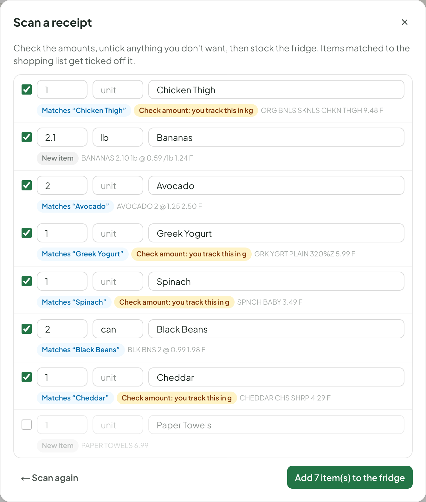
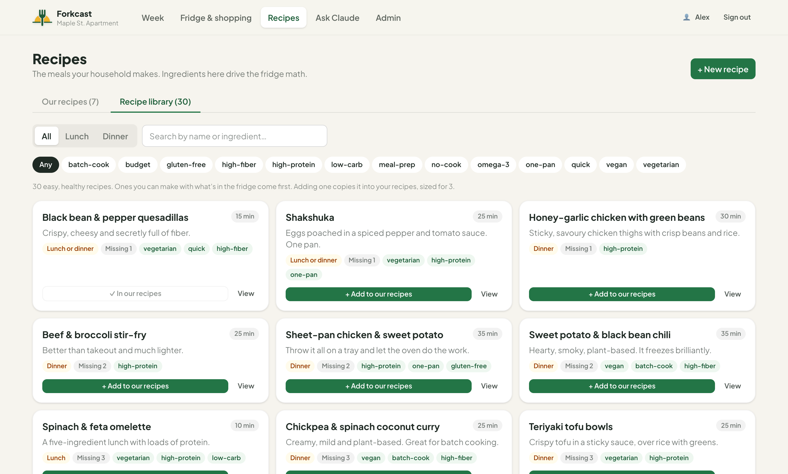
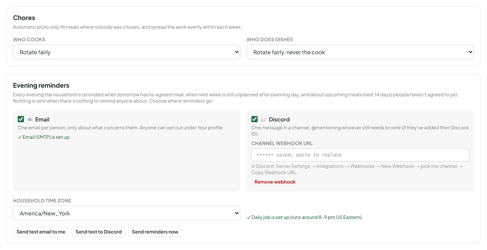

<div align="center">

<picture>
  <source media="(prefers-color-scheme: dark)" srcset="docs/logo-dark.svg">
  
</picture>

# Forkcast

**The free, self-hosted meal planner for people who share a fridge.**

[](CHANGELOG.md)
[](https://nextjs.org)
[](https://react.dev)
[](https://vercel.com/new)
[](https://console.anthropic.com)
[](#deploy-your-own-free)

Vote on the week's meals together, see which days you'll be short on food *before* you get there,<br>
split the cooking and the dishes fairly, and let the fridge keep track of itself.

[Why](#why-forkcast) · [Features](#features) · [How it works](#how-it-works) · [Deploy](#deploy-your-own-free) · [Reminders setup](#set-up-reminders) · [Privacy](#your-data-stays-yours) · [Security](#lock-down-your-vercel-account) · [Run locally](#run-it-locally) · [Good to know](#good-to-know)

</div>

## Why Forkcast?

Living with roommates usually means a group chat full of *"what are we eating?"*, three bags of rice nobody remembers buying, and finding out at 7 pm that someone used the last of the chicken. Forkcast turns your household's food into one shared plan: everyone proposes and votes on meals, the app checks the plan against the fridge day by day, and cooking a meal takes its ingredients out of the fridge for you. It runs on Vercel's free tier, with your data in your own private storage.


<p align="center"><sub>Screenshots use a made-up demo household.</sub></p>

---

## Features

### 🗳️ Plan the week together

- **Propose and vote.** Anyone can propose a meal and everyone else votes. Admins choose whether one vote, most roommates, or everyone is needed for a meal to be agreed.
- **Planning day.** Pick a day (Friday by default). On that day everyone sees a banner to plan next week, and the evening reminder nudges anyone who hasn't.
- **Repeat last week.** Liked last week? One click fills just the empty slots with the same meals.
- **Week or month.** Flip to the calendar to see which days had meals planned or made, jump to any date, and click a day to open its week. The numbers at the top of the week (planned, waiting on votes, short on food, cooked) open the list of meals behind them.
- **Your slots, your way.** Lunch, dinner, or any slots you like. Drag meals between days, skip them, or remove them from the plan.

### 🧑‍🍳 Who cooks and who cleans

- **Every meal has a cook 👩‍🍳 and a dishwasher 🧽**, shown right on the meal. Pick them yourselves, or let Forkcast do it.
- **Fair rotation.** In **Admin → Settings → Chores**, set cooking and dishes to rotate fairly. New meals are filled automatically, the work is spread evenly within each week, and meals where someone was already chosen are left alone.
- **"Never the cook."** Dishes can rotate so whoever cooked never also washes up.
- **No surprises.** The evening reminder says who is cooking and who is on dishes tomorrow.

### 🧊 A fridge that keeps itself up to date

- **Cook it and it's gone.** Hit **Cooked** and the ingredients come out of the fridge, scaled to how many people you cooked for. Made a mistake? **Undo** puts them back.
- **Real units.** 500 g covers "0.4 kg", and 1 l covers "2 cups".
- **Staples are assumed.** Salt, pepper and water (editable in Settings) are always on hand and never counted against the fridge.
- **Forgiving names.** Upper and lower case don't matter and names are shown in Title Case ("chicken THIGH" → "Chicken Thigh"), and "Tomatoes" matches "tomato".

### 🛒 Know before you're short

- **A day-by-day forecast.** Forkcast walks through the week in order, pulling ingredients from the fridge, and labels every meal **In fridge**, **After shopping** or **Short**, with exactly what's missing.
- **Dated shopping trips.** Give a grocery run a day and it counts from that day onward. Shopping on Tuesday? Monday's dinner still shows as short.
- **One-click shopping list.** Everything you're missing becomes a dated shopping list. **Bought** moves it straight into the fridge.
- **See what the plan will use.** Each fridge item shows how much of it the upcoming meals need.

<p align="center">
  
</p>

### 🧾 Scan receipts, right from your phone

- **Quick scan** reads the receipt on your phone, for free. The photo never leaves your device.
- **Claude scan** decodes store abbreviations, works out amounts and skips non-food.
- **Smart matching.** Both match items to your shopping list and to the food names you already use, and tick them off the list.
- **You stay in charge.** Review every item before it's added; untick anything you don't want in the fridge.
- **Made for the store.** A proper mobile layout with bottom navigation, for checking the fridge mid-aisle.

<table>
  <tr>
    <td width="66%" valign="top"></td>
    <td width="34%" valign="top" align="center"></td>
  </tr>
  <tr>
    <td align="center"><sub>Review a scan before anything is added</sub></td>
    <td align="center"><sub>The week planner on a phone</sub></td>
  </tr>
</table>

### 📖 Recipes

- **Calories, automatically.** Saving a recipe gets a per-serving estimate (calories, protein, carbs, fat) from Claude in the background; library recipes have built-in estimates. Meals show ~kcal per serving and each day shows a rough per-person total.

- **Your recipe box.** The household's own recipes, with a **Can make now** badge based on what's in the fridge.
- **A built-in library.** 30 easy, healthy lunches and dinners (15–40 min), sorted by what you can make right now and filterable.
- **Add to our recipes.** One click copies a library recipe into your recipe box, sized for your household.
- **Ask Claude.** *"Something cozy with the leftover chicken"* gets you recipe ideas built around your fridge. Save any idea with one click.

<p align="center">
  
</p>

### 📬 Evening reminders

- **Email, Discord, or both.** Admins pick the channels; Forkcast only speaks up when there's something to say.
- **Three kinds of nudge:** meals waiting on your vote, nothing agreed for tomorrow, and next week still unplanned after planning day.
- **Tomorrow's chores included:** who is cooking and who is on dishes.
- **Respectful by default.** At most one email per person per evening, and anyone can turn their own reminder emails off.
- **Discord @mentions.** One message for the household that @mentions whoever still needs to vote, never `@everyone`.

<p align="center">
  
</p>

### 🔐 Accounts and admin

- **Email and password accounts.** The first account becomes the admin; new members wait for an admin to approve them, and nothing is visible without a login.
- **Close the door.** Once everyone has joined, set `ALLOW_SIGNUPS=false` to stop new sign-up requests.
- **Your own profile.** Everyone can change their own display name, turn off reminder emails and add a Discord ID for @mentions. Nobody can change anyone else's.
- **Always know what's running.** The version shows in the footer, on the login page and in **Admin → Settings**.
- **Show password.** Tap the eye in the password field to check what you typed.

### 📱 Made for your phone

- **Phone-first layout.** One day at a time with a day picker, big tap targets, bottom navigation and bottom-sheet dialogs. No sideways scrolling and no zooming in when you type.
- **Add to Home Screen.** Open Forkcast in Safari or Chrome and choose *Add to Home Screen*: it gets its own icon and opens full screen like an app.

## How it works

```
 Propose meal ──► Roommates vote ──► Forecast checks the fridge, day by day
                                            │
                       ┌────────────────────┼─────────────────────┐
                    In fridge         After shopping            Short
                                     (covered by a dated     (shows exactly
                                      shopping-list item)     what's missing)
                                            │
                 Cook it ──► ingredients leave the fridge ──► forecast updates
```

**Built with** Next.js 16 · React 19 · Tailwind CSS 4 · Vercel Blob · the Anthropic TypeScript SDK · nodemailer · tesseract.js

---

## Deploy your own (free)

Forkcast is a single Next.js app that runs on Vercel's free tier. There's no database to set up: your household's data is a handful of JSON files in a private Vercel Blob store.

1. **Fork this repo**, then import your fork at [vercel.com/new](https://vercel.com/new).
2. In your Vercel project, open **Storage → Create → Blob**, choose **Private** access, and connect the store to the project. This sets `BLOB_READ_WRITE_TOKEN` or `BLOB_STORE_ID` automatically (either works).
3. In **Settings → Environment Variables**, add these for **Production and Preview**:

   | Variable | Required | What it's for |
   |---|---|---|
   | `AUTH_SECRET` | ✅ | Signs login sessions. Use a long random string, e.g. the output of `openssl rand -base64 32`. |
   | `ANTHROPIC_API_KEY` | | Turns on *Ask Claude* and *Claude scan*. You can also paste the key in **Admin → Settings** instead. |
   | `ADMIN_EMAILS` | | Comma-separated emails that become admins automatically when they sign up. |
   | `ALLOW_SIGNUPS` | | Set to `false` once everyone has joined, to stop new sign-up requests. |
   | `IDEAS_DAILY_LIMIT` | | Claude requests (ideas + receipt scans) per person per day (default 20). |
   | `NUTRITION_DAILY_LIMIT` | | Automatic calorie analyses per household per day (default 60). |
   | `CRON_SECRET` | for reminders | A long random string. Vercel sends it to the daily reminder job so nobody else can trigger it. |
   | `SMTP_HOST`, `SMTP_PORT`, `SMTP_USER`, `SMTP_PASS` | for email reminders | Where reminder emails are sent from. See [Set up reminders](#set-up-reminders). |
   | `DISCORD_WEBHOOK_URL` | | Posts reminders to a Discord channel. You can also paste it in **Admin → Settings** instead. |
   | `EMAIL_FROM` | | Sender, e.g. `Forkcast <you@gmail.com>`. Required if `SMTP_USER` isn't an email address. |
   | `APP_URL` | | Link used in emails. Defaults to your Vercel production URL. |

4. **Redeploy** (environment changes only apply to new deployments), open your site, and **create your account first**. The first account becomes the admin.
5. Share the link with your roommates and approve them under **Admin**.

> [!NOTE]
> **Seeing "Setup needed: …" when you sign up?** The message names the missing setting. Fix it in Vercel, then redeploy.

> [!TIP]
> Leave Vercel's **Git Fork Protection** on (it's on by default). Pull requests from other people's forks then can't run with your environment variables until you approve them.

## Set up reminders

Every evening (around 8–9 pm US Eastern; change the time in `vercel.json`, which uses UTC), Forkcast checks the plan and speaks up only if there's something to say:

| | Reminder | When |
|---|---|---|
| 🗳️ | **Meals waiting on your vote** | Upcoming meals (next 14 days) you haven't agreed to yet. |
| 🍽️ | **Nothing agreed for tomorrow** | Lists the empty slots or the meals still waiting on votes. |
| 📅 | **Planning day was missed** | From planning day until the week starts, if next week still has empty days. |

Reminders also say who is cooking and who is on dishes tomorrow. Admins choose the channels under **Admin → Settings → Evening reminders**: 📧 email, 💬 Discord, or both. They share the same daily job (`CRON_SECRET` is required either way) and the household time zone.

### Email

Each roommate gets **at most one** email per evening. Vote reminders go just to you; the rest go to everyone. Don't want them? Click your name in the header and turn off reminder emails under **Your profile**.

<details>
<summary><b>Set up email with a Gmail account</b> (free, no domain needed)</summary>

1. Turn on [2-Step Verification](https://myaccount.google.com/security) for the Gmail account that will send the emails.
2. Create an [app password](https://myaccount.google.com/apppasswords) named "Forkcast".
3. In Vercel, set `SMTP_HOST=smtp.gmail.com`, `SMTP_PORT=465`, `SMTP_USER=` that Gmail address, `SMTP_PASS=` the app password, and a random `CRON_SECRET`. Then redeploy.
4. In **Admin → Settings**, pick your time zone and click **Send test email to me**, then **Send reminders now**.

Any SMTP provider works (Resend, Postmark, SendGrid, Fastmail…). If its login isn't an email address, also set `EMAIL_FROM`. Admins can turn the emails off in Settings.

</details>

### Discord

Discord gets **one** combined message per evening in the channel you pick, with a **Waiting on votes** list.

<details>
<summary><b>Set up a Discord webhook</b></summary>

1. In Discord, open **Server Settings → Integrations → Webhooks → New Webhook**, choose the channel, and click **Copy Webhook URL**.
2. Paste it in **Admin → Settings → Evening reminders**, or set `DISCORD_WEBHOOK_URL` in Vercel and redeploy (the environment variable wins). The URL stays on the server and never reaches the browser. Only real `https://discord.com/api/webhooks/…` URLs are accepted.
3. Turn on Discord and click **Send test to Discord**.

</details>

<details>
<summary><b>Get @mentioned on Discord</b></summary>

In Discord, open **User Settings → Advanced**, turn on **Developer Mode**, then right-click your name and **Copy User ID**. Paste it under **Your profile**. People without an ID are listed by name. Forkcast only pings those user IDs, never `@everyone`.

</details>

## Your data stays yours

This repository holds **code only**, so it's safe to keep public.

- **No household data in git.** Meals, recipes, fridge contents, shopping lists and accounts live in *your* private Blob store (or a git-ignored `./.data/` folder when running locally). Planning and cooking never create a commit.
- **No secrets in git.** All keys live in environment variables, and `.env*` files are ignored.
- **Nothing visible without an approved account.** Every API route checks for one. Pending sign-ups only see their own status. Password hashes and API keys never reach the browser.
- **Hidden from search engines.** The app sends `noindex` headers and a `robots.txt` that blocks all crawlers.
- **Protected against password guessing.** After eight wrong passwords in a row, an account locks for 15 minutes.
- **Abuse limits built in.** Sign-in and sign-up are rate-limited per IP, at most 10 sign-ups can wait for approval at once, request bodies are capped at 64 KB, and API changes are only accepted from your own site (CSRF protection).
- **Capped AI spend.** Each person gets 20 Claude requests (ideas and receipt scans) per day (change it with `IDEAS_DAILY_LIMIT`), so a leaked password can't run up your API bill.
- **Safe concurrent edits.** Saves are conditional on the file's version, so two roommates saving at the same moment can't overwrite each other.

**What leaves your server:** *Ask Claude* and *Claude scan* are the only features that send household data to a third party: your request, fridge list or receipt photo goes to the Claude API. *Quick scan* keeps the photo on your device; it only downloads the open-source text reader (Tesseract) from a CDN. Reminder emails go through the SMTP provider you choose. Discord reminders post meal titles and names to the Discord channel you choose.

## Lock down your Vercel account

The app protects itself, but your Vercel, GitHub and Anthropic accounts are what an attacker would really want. Ten minutes of setup:

- [ ] **Turn on two-factor authentication** for [Vercel](https://vercel.com/account/security), [GitHub](https://github.com/settings/security) and the [Anthropic Console](https://console.anthropic.com). Passkeys are best.
- [ ] **Cap your spending.**
  - On Vercel's free *Hobby* plan, usage over the free limits pauses the project instead of billing you.
  - On *Pro*, open **Settings → Billing → Spend Management**, set a monthly budget, and turn on *pause production deployment*.
  - In the Anthropic Console, set a monthly **spend limit** on the key you give Forkcast, and use a key made only for Forkcast.
- [ ] **Add a firewall rate limit.** In **Firewall → Configure → Add rule**: if *Request Path* starts with `/api/auth/`, rate-limit to 30 requests per minute per IP. This global limit backs up the app's own per-instance limits. If you're ever under attack, turn on **Attack Challenge Mode** in the same place.
- [ ] **Keep preview deployments private.** **Settings → Deployment Protection → Vercel Authentication** should be on (the default), so only your team can open preview URLs.
- [ ] **Keep Git Fork Protection on** (**Settings → Git**, on by default). Pull requests from strangers' forks can't build with your environment variables until you approve them.
- [ ] **Keep keys server-only.** Leave `AUTH_SECRET`, `BLOB_READ_WRITE_TOKEN` and `ANTHROPIC_API_KEY` as normal (server-only) environment variables. Never prefix them with `NEXT_PUBLIC_`, which would ship them to every browser.
- [ ] **Rotate if in doubt.** Changing `AUTH_SECRET` signs everyone out. Regenerate the Blob token or Claude key from their dashboards if they might have leaked.

Dependabot (`.github/dependabot.yml`) opens a pull request each week with dependency updates, including security fixes.

## Run it locally

```bash
npm install
npm run dev
```

Open [http://localhost:3000](http://localhost:3000) and create an account. Without `BLOB_READ_WRITE_TOKEN`, data is saved to `./.data/`. To try *Ask Claude*, add `ANTHROPIC_API_KEY` to `.env.local` (see [`.env.example`](.env.example)) or paste a key in **Admin → Settings**.

## Good to know

- **Units:** amounts convert within weight (g, kg, oz, lb), volume (ml, l, tsp, tbsp, cup) and counts. Different kinds don't mix ("1 can" won't match "400 g"), so use the same unit in recipes and in the fridge.
- **Names:** matching ignores case and is forgiving about plurals: "Tomatoes" matches "tomato".
- **Staples:** salt, pepper and water (editable in Settings) are assumed always on hand and never counted against the fridge.
- **Claude model:** defaults to Claude Opus 5.5. Admins can switch to Sonnet or Haiku for cheaper requests.
- **Version:** the running version (e.g. *Forkcast v0.6.2*) shows in the footer, on the login page and in **Admin → Settings**. Every change bumps it; see [`CHANGELOG.md`](CHANGELOG.md) for what's new.

## Contributing

Issues and pull requests are welcome. Please don't include real household data in screenshots or bug reports; a made-up household works just as well.
