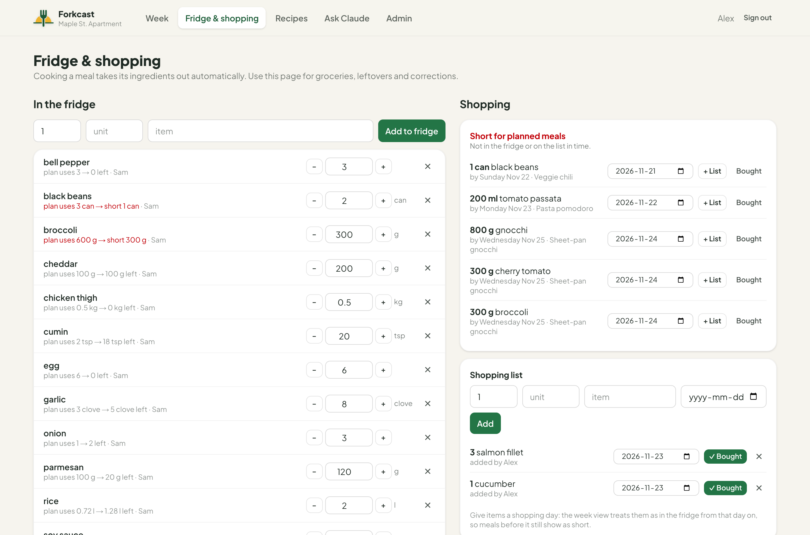

<div align="center">


# Forkcast

**The meal planner for people who share a fridge.**

Vote on the week's meals together, see which days you'll be short on food *before* you get there, and let the fridge keep track of itself.

[Features](#features) · [Screenshots](#screenshots) · [Deploy your own](#deploy-your-own-free) · [Privacy](#your-data-stays-yours) · [Security](#lock-down-your-vercel-account) · [Run locally](#run-it-locally)

</div>


---

## Why Forkcast?

Living with roommates usually means a group chat full of *"what are we eating?"*, three bags of rice nobody remembers buying, and finding out at 7 pm that someone used the last of the chicken.

Forkcast makes your household's food one shared plan:

- **Decide together.** Anyone can propose a meal, and everyone else votes. You choose whether one vote, a majority, or the whole household is needed.
- **Know before you're short.** Forkcast walks through the week day by day, pulling ingredients from the fridge, and tells you exactly which meal comes up short and what's missing.
- **The fridge updates itself.** Hit **Cooked** and the ingredients come out of the fridge, scaled to how many people you cooked for. Made a mistake? **Undo** puts them back.
- **Shop at the right time.** Give a grocery run a day, and Forkcast counts it from that day onward. If you shop on Tuesday, Monday's dinner still shows as short.

## Features

| | |
|---|---|
| 📅 **Flexible week planner** | Lunch, dinner, or any slots you like. Drag meals between days, skip them, or say who's cooking. |
| 🗳️ **Planning day** | Pick a day (Friday by default) and everyone gets a reminder to plan the week ahead. |
| 🧊 **Live fridge** | Quantities with real units: 500 g covers "0.4 kg", and 1 l covers "2 cups". |
| 🛒 **Smart shopping list** | One click turns everything you're missing into a dated shopping list. **Bought** moves it into the fridge. |
| 📖 **Recipe box** | Your household's recipes, with a "Can make now" badge based on what's in the fridge. |
| ✨ **Ask Claude** | *"Something cozy with the leftover chicken"* gets you recipe ideas built around your fridge. Save any idea with one click. |
| 🔐 **Private by design** | Email and password accounts. New members wait for an admin to approve them, and nothing is visible without a login. |
| 📱 **Works on your phone** | A proper mobile layout with bottom navigation, made for checking the fridge at the store. |

## Screenshots

<table>
<tr>
<td width="68%"></td>
<td width="32%"></td>
</tr>
<tr>
<td colspan="2"></td>
</tr>
</table>

<sub>Screenshots use a made-up demo household.</sub>

## How it works

```
 Propose meal ──► Roommates vote ──► Forecast checks the fridge, day by day
                                            │
                       ┌────────────────────┼─────────────────────┐
                    In fridge         After shopping            Short
                                     (covered by a dated     (shows exactly
                                      shopping-list item)     what's missing)
                                            │
                 Cook it ──► ingredients leave the fridge ──► forecast updates
```

## Deploy your own (free)

Forkcast is a single Next.js app that runs on Vercel's free tier. No database to set up: your household's data is a handful of JSON files in a private Vercel Blob store.

1. **Fork this repo**, then import your fork at [vercel.com/new](https://vercel.com/new).
2. In your Vercel project, open **Storage → Create → Blob**, choose **Private** access, and connect the store to the project. This sets `BLOB_READ_WRITE_TOKEN` automatically.
3. In **Settings → Environment Variables**, add these for **Production and Preview**:

   | Variable | Required | What it's for |
   |---|---|---|
   | `AUTH_SECRET` | ✅ | Signs login sessions. Use a long random string, e.g. the output of `openssl rand -base64 32`. |
   | `ANTHROPIC_API_KEY` | | Turns on *Ask Claude*. You can also paste the key in **Admin → Settings** instead. |
   | `ADMIN_EMAILS` | | Comma-separated emails that become admins automatically when they sign up. |
   | `ALLOW_SIGNUPS` | | Set to `false` once everyone has joined, to stop new sign-up requests. |
   | `IDEAS_DAILY_LIMIT` | | *Ask Claude* requests per person per day (default 20). |

4. **Deploy**, open your site, and **create your account first**. The first account becomes the admin.
5. Share the link with your roommates and approve them under **Admin**.

> **Tip:** leave Vercel's **Git Fork Protection** on (it's on by default). Pull requests from other people's forks then can't run with your environment variables until you approve them.

## Your data stays yours

This repository holds **code only**, so it's safe to keep public:

- **No household data in git.** Meals, recipes, fridge contents, shopping lists and accounts live in *your* private Blob store (or a git-ignored `./.data/` folder when running locally). Planning and cooking never create a commit.
- **No secrets in git.** All keys live in environment variables. `.env*` files are ignored.
- **Nothing visible without an approved account.** Every API route checks for one. Pending sign-ups only see their own status. Password hashes and API keys never reach the browser.
- **Hidden from search engines.** The app sends `noindex` headers and a `robots.txt` that blocks all crawlers.
- **Protected against password guessing.** After eight wrong passwords in a row, an account locks for 15 minutes.
- **Abuse limits built in.** Sign-in and sign-up are rate-limited per IP, at most 10 sign-ups can wait for approval at once, request bodies are capped at 64 KB, and API changes are only accepted from your own site (CSRF protection).
- **Capped AI spend.** Each person gets 20 *Ask Claude* requests per day (change it with `IDEAS_DAILY_LIMIT`), so a leaked password can't run up your API bill.
- **Safe concurrent edits.** Saves are conditional on the file's version, so two roommates saving at the same moment can't overwrite each other.

*Ask Claude* is the only feature that sends anything to a third party. When you use it, your request and your fridge list go to the Claude API.

## Lock down your Vercel account

The app protects itself, but your Vercel, GitHub and Anthropic accounts are what an attacker would really want. Ten minutes of setup:

1. **Turn on two-factor authentication** for [Vercel](https://vercel.com/account/security), [GitHub](https://github.com/settings/security) and the [Anthropic Console](https://console.anthropic.com). Passkeys are best.
2. **Cap your spending.**
   - On Vercel's free *Hobby* plan, usage over the free limits pauses the project instead of billing you.
   - On *Pro*, open **Settings → Billing → Spend Management**, set a monthly budget, and turn on *pause production deployment*.
   - In the Anthropic Console, set a monthly **spend limit** on the key you give Forkcast, and use a key made only for Forkcast.
3. **Add a firewall rate limit.** In **Firewall → Configure → Add rule**: if *Request Path* starts with `/api/auth/`, rate-limit to 30 requests per minute per IP. This is a global limit that backs up the app's own per-instance limits. If you're ever under attack, turn on **Attack Challenge Mode** in the same place.
4. **Keep preview deployments private.** **Settings → Deployment Protection → Vercel Authentication** should be on (the default), so only your team can open preview URLs.
5. **Keep Git Fork Protection on** (**Settings → Git**, on by default). Pull requests from strangers' forks can't build with your environment variables until you approve them.
6. **Only mark keys as needed.** Leave `AUTH_SECRET`, `BLOB_READ_WRITE_TOKEN` and `ANTHROPIC_API_KEY` as normal (server-only) environment variables. Never prefix them with `NEXT_PUBLIC_`, which would ship them to every browser.
7. **Rotate if in doubt.** Changing `AUTH_SECRET` signs everyone out. Regenerate the Blob token or Claude key from their dashboards if they might have leaked.

Dependabot (`.github/dependabot.yml`) opens a pull request each week with dependency updates, including security fixes.

## Run it locally

```bash
npm install
```

```bash
npm run dev
```

Open [http://localhost:3000](http://localhost:3000) and create an account. Without `BLOB_READ_WRITE_TOKEN`, data is saved to `./.data/`. To try *Ask Claude*, add `ANTHROPIC_API_KEY` to `.env.local` (see [`.env.example`](.env.example)) or paste a key in **Admin → Settings**.

**Built with:** Next.js 16 · React 19 · Tailwind CSS 4 · Vercel Blob · the Anthropic TypeScript SDK

## Good to know

- **Units:** amounts convert within weight (g, kg, oz, lb), volume (ml, l, tsp, tbsp, cup) and counts. Different kinds don't mix ("1 can" won't match "400 g"), so use the same unit in recipes and in the fridge.
- **Names:** matching is forgiving: "Tomatoes" matches "tomato".
- **Staples:** salt, pepper and water (editable in Settings) are assumed always on hand and never counted against the fridge.
- **Claude model:** defaults to Claude Opus 5.5. Admins can switch to Sonnet or Haiku for cheaper requests.

## Contributing

Issues and pull requests are welcome! Please don't include real household data in screenshots or bug reports. A made-up household works just as well.
